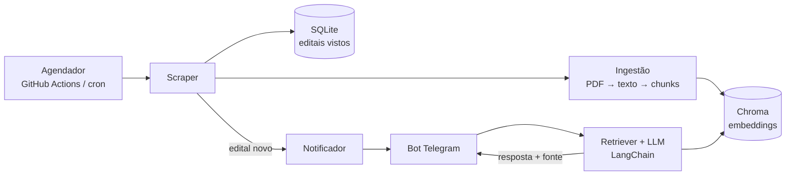

# 📢 Monitor de Editais UFC

Bot de Telegram que monitora editais, resoluções e o calendário acadêmico da UFC, responde perguntas sobre eles **citando a fonte** e avisa quando sai um edital novo.

> 🚧 **Status:** em desenvolvimento (etapa 0). Veja o [roadmap](#-roadmap) e o [ROADMAP.md](ROADMAP.md) detalhado.

Projeto feito com **PBL (aprendizagem baseada em projetos)**: cada etapa existe para ensinar um conceito, e o aprendizado de cada uma fica registrado abaixo.

---

## ✨ O que ele faz

- 🕷️ **Coleta** periodicamente editais, resoluções e o calendário acadêmico
- 🔎 **Indexa** o conteúdo dos PDFs para busca semântica
- 💬 **Responde** perguntas como _"quais os requisitos do edital X?"_ com **citação** (documento, página e link)
- 🔔 **Avisa** no Telegram quando um edital novo é publicado

## 🏗️ Arquitetura



## 🧰 Stack

| Parte | Tecnologia |
|---|---|
| Linguagem | Python 3.11+ |
| Scraping | `requests`, `beautifulsoup4` |
| PDFs | `pymupdf` |
| Banco de editais | SQLite |
| Vetores | Chroma |
| RAG | LangChain (retriever + citação de fonte) |
| Bot | `python-telegram-bot` |
| Agendamento / CI | GitHub Actions (`schedule: cron`) |
| Qualidade | `pytest`, `ruff` |

## 📁 Estrutura

```
monitor-editais-ufc/
├── src/
│   ├── scraper/     # coleta e parsing das páginas
│   ├── rag/         # ingestão, índice vetorial, retriever, cadeia
│   └── bot/         # handlers do Telegram e notificações
├── tests/           # testes (com HTML de exemplo como fixture)
├── data/            # SQLite e PDFs baixados (ignorados no git)
├── .github/workflows/
├── .env.example
├── requirements.txt
├── ROADMAP.md
└── README.md
```

## 🚀 Como rodar

```bash
git clone https://github.com/<seu-usuario>/monitor-editais-ufc.git
cd monitor-editais-ufc
python -m venv .venv && source .venv/bin/activate
pip install -r requirements.txt
cp .env.example .env   # preencha as variáveis
```

### Variáveis de ambiente

| Variável | Para que serve |
|---|---|
| `TELEGRAM_BOT_TOKEN` | Token do bot (criado com o @BotFather) |
| `TELEGRAM_CHAT_ID` | Chat que recebe os avisos de edital novo |
| `LLM_API_KEY` | Chave do provedor de LLM/embeddings |

> Os comandos de execução (scraper, ingestão, bot) serão documentados conforme as etapas forem concluídas.

## 🗺️ Roadmap

Detalhes de branches, commits e critérios de pronto em [ROADMAP.md](ROADMAP.md).

- [ ] **Etapa 0** · Setup do repositório, lint e CI
- [ ] **Etapa 1** · Scraper de uma página de editais
- [ ] **Etapa 2** · Detecção de editais novos (SQLite)
- [ ] **Etapa 3** · Ingestão de PDFs (extração + chunking)
- [ ] **Etapa 4** · Índice vetorial e retriever
- [ ] **Etapa 5** · RAG com citação da fonte
- [ ] **Etapa 6** · Bot de Telegram
- [ ] **Etapa 7** · Agendamento e notificações
- [ ] **Etapa 8** · Avaliação do retriever
- [ ] **Etapa 9** · Polimento e release v1.0

## 🧠 O que aprendi

_Preencha ao concluir cada etapa (conceito, erro que me ensinou algo, decisão tomada)._

| Etapa | Aprendizado |
|---|---|
| 1 | _…_ |
| 2 | _…_ |

## ⚠️ Limitações

- As respostas são geradas por LLM a partir dos documentos indexados e **não substituem a leitura do edital oficial**. Sempre confira a fonte citada.
- Projeto independente, sem vínculo oficial com a UFC.

## 🤝 Convenções

- Branches: `feat/<nome>`, `chore/<nome>`, `docs/<nome>`
- Commits: [Conventional Commits](https://www.conventionalcommits.org/pt-br/v1.0.0/)
- Toda mudança entra na `main` via Pull Request

## 📄 Licença

A definir (sugestão: MIT).
